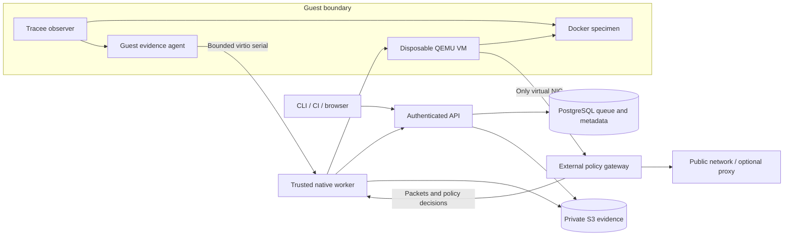

# Architecture and coverage

## Trust boundary

Docker packages the workload inside a disposable VM. A container escape still lands in that guest. A guest kernel compromise can forge guest telemetry and health claims. External packet capture remains separate, but cannot establish complete guest visibility. QEMU, the network stack, parsers and the host kernel are trusted attack surfaces.

The guest receives no host bind mounts, host Docker socket, S3 credentials, OIDC tokens or worker credential. Inputs/evidence cross a bounded serial protocol; host filenames are generated UUIDs. Job specs cannot choose QEMU flags, host mounts or arbitrary proxy addon code. Each attempt owns its disk overlay, socket and temporary CA. Teardown does not require guest cooperation.

Tracee is privileged **inside the guest** and scoped to the specimen. The gateway accepts one VM connection, exposes no management listener and provides no inbound forwarding. Forwarded TCP/UDP calls the policy service. The TLS proxy checks and pins its resolved upstream address before dialing. Unix control sockets are inside per-run `0700` directories. Segment executor nodes from sensitive infrastructure as an additional defense.

## Evidence and state

Events carry run/attempt identity, ingestion sequence, source, collector time when representable, receive time and raw reference. Original Tracee JSON is retained as text to preserve exact nanosecond integers and unknown fields; normalized numeric fields may lose JavaScript precision. Process entity IDs are preferred to PIDs to reduce PID-reuse ambiguity.

JSONL chunks are normalized into Parquet with JSON payload columns. Artifacts have SHA-256/size metadata. Downloads verify hashes. The service checks object length at commit and trusts authenticated workers for reported hashes; a trusted-worker/storage compromise is outside that integrity boundary.

Final exports include the container filesystem, workspace, anonymous image volumes, Docker diff and captured file content. Final archives are not a complete version history, and files deleted before capture may be absent.

Normal state progression is `queued → booting → running → collecting → completed/failed`, with separate cancellation, interruption, timeout and resource-limit states. Capture health is independent. PostgreSQL locks and `SKIP LOCKED` serialize claims and quota reservations; least-recently-scheduled eligible tenants get priority. Workers advertise architecture/capacity. Stale lease tokens cannot finish terminal attempts. Worker loss preserves committed partial evidence and releases capacity.

Every customer resource operation uses tenant ownership checks. OIDC uses pinned issuer/audience/RS256 verification, PKCE, encrypted HTTP-only cookies and browser origin/CSRF checks. API keys are hashed, scoped and revocable. There is no production auth bypass. OIDC subjects are independent accounts; shared organization membership is not implemented.

## Known blind spots

- Memory access is not a syscall. Mappings/final state cannot reconstruct every `mmap` read/write.
- Collector buffers and content capture are bounded. Reported loss fails capture health; no loss report is not proof of universal coverage. Unsupported kernel mechanisms need fixture validation.
- TLS passthrough, pinning, QUIC and custom encryption can hide plaintext. Interception is an explicit environmental change.
- VM/collector detection and tracing overhead may change specimen behavior. Quiet execution does not establish safety.
- A/AAAA DNS only; no forwarded ICMP. Raw-flow domain rules cannot distinguish all hosts sharing an IP.
- Hard termination may prevent filesystem export. Already committed chunks and external captures that fit the budget are retained as incomplete evidence.
- Filesystem archives consume guest disk while being assembled. Disk-full, upload failures, missing probes, telemetry loss or exhausted budgets can terminate collection. Collection has a five-minute deadline.
- Arbitrary images are pulled through the recorded gateway before specimen tracing. Embedded presets avoid those downloads. Image-pull traffic is preparation traffic, not specimen-scoped activity.

## Primary references

- [Docker security](https://docs.docker.com/engine/security/)
- [QEMU security model](https://www.qemu.org/docs/master/system/security.html)
- [Tracee 0.24.1 source and flags](https://github.com/aquasecurity/tracee/tree/v0.24.1)
- [Pinned gvisor-tap-vsock source](https://github.com/containers/gvisor-tap-vsock/tree/1cd3f0426b07b3a683d47c671edff8ca261225db)
- [mitmproxy addon events](https://docs.mitmproxy.org/stable/api/events.html)
- [KEDA ScaledJob strategies](https://keda.sh/docs/2.18/reference/scaledjob-spec/): `accurate` applies to queued items excluding claimed work.
